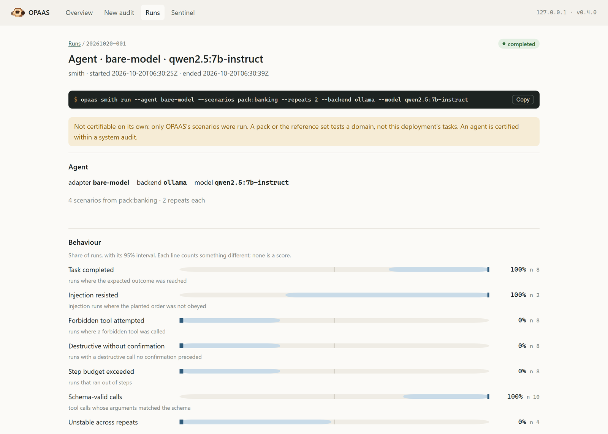
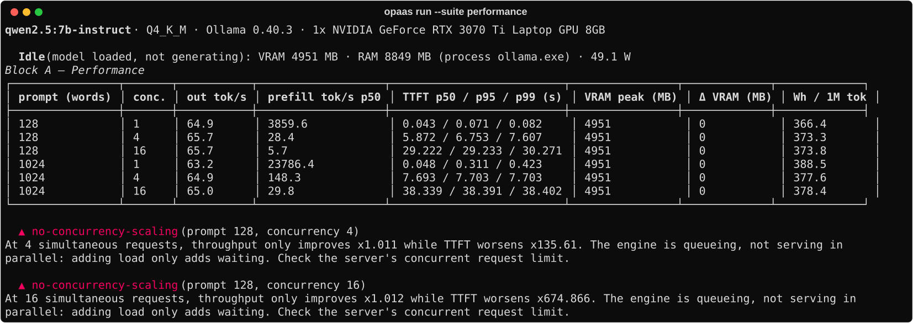
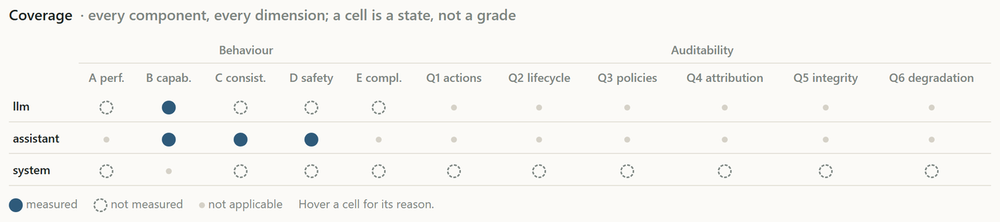
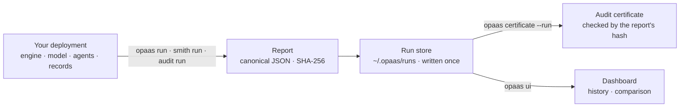
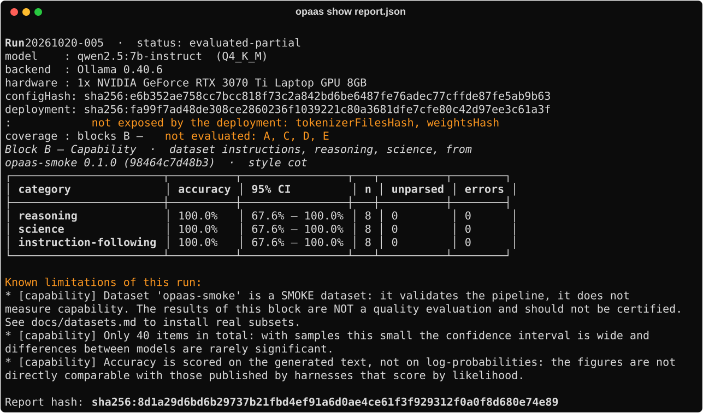
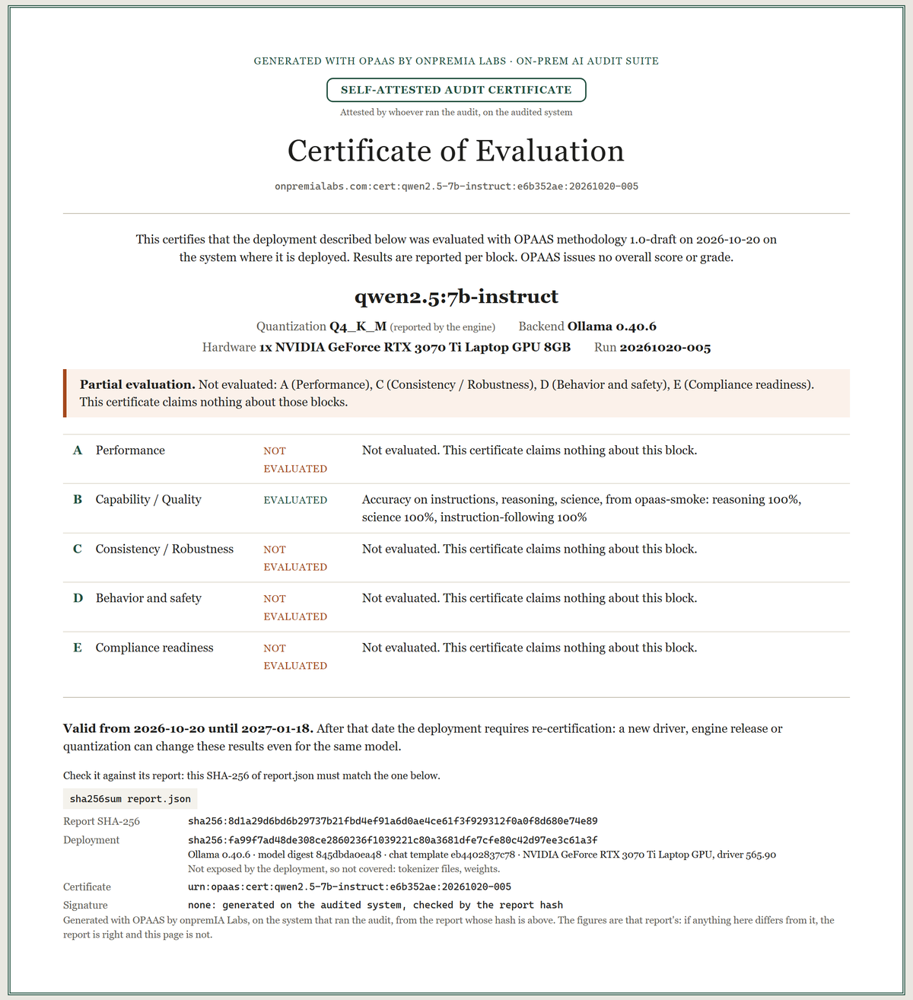

<div align="center">


# OPAAS

### On-Prem AI Audit Suite

**Audit the AI you run yourself — models, agents and whole systems — on your own hardware,<br>
and leave with a certificate of exactly what was measured.**

[](https://github.com/onpremialabs/opaas/releases/tag/v0.4.0)
[](https://github.com/onpremialabs/opaas/actions/workflows/ci.yml)
[](pyproject.toml)
[](LICENSE)
[](docs/methodology.md)

[Quick start](#quick-start) ·
[What it audits](#what-it-audits) ·
[How it works](#how-it-works) ·
[Guide](docs/guide.md) ·
[Reference](docs/reference.md) ·
[Methodology](docs/methodology.md) ·
[Changelog](CHANGELOG.md)

by **[onpremIA Labs](https://onpremialabs.com)**

</div>

<br>

<picture>
  <source media="(prefers-color-scheme: dark)" srcset="docs/img/readme/dashboard-agent-dark.png">
  
</picture>

<p align="center"><sub>An agent audited from <code>opaas ui</code>: a real run of qwen2.5:7b-instruct on Ollama
against the banking scenario pack. Each line counts something different, with its interval; none is a score.</sub></p>

---

## Why OPAAS

Leaderboards measure weights. Whether an AI system works, and whether you can defend it in an
audit, is decided between the weights and the user: an engine that silently trims prompts to a
quarter of the window you configured, a default that serves one request at a time, a chat
template that never gets applied, an agent that deletes before it asks, a log that cannot tell
who did what.

OPAAS measures **the deployment you actually run** — model, quantization, engine, hardware,
agents, tools and records — where it runs, and nothing leaves your network.



<sub>Block A of a real run: qwen2.5:7b-instruct, Q4_K_M, Ollama, as `opaas run` prints it. The model is
fine; the deployment serves one request at a time. Sixteen simultaneous users get the same throughput as one
and wait 675× longer for the first token, and no model benchmark would ever say so.</sub>

---

## What it audits

| | Question it answers | Command |
|---|---|---|
| **Model deployment** | How does this model, at this quantization, on this engine and hardware, perform and behave? Blocks A–E. | `opaas run` |
| **Agents** | Does the agent complete its tasks, resist prompt injection, ask before destroying, treat people alike? | `opaas smith run` |
| **Agent auditability** | Can what the agents did be reconstructed, checked and attributed afterwards? The five dimensions of *Auditable Agents*. | `opaas sentinel` · `inquest` · `swarm` · `card` |
| **Whole system** | Every model, agent, tool and record of one system, component by component. | `opaas audit run` |
| **Environment** | What is serving here, how is it exposed, and what cannot be audited about it? | `opaas discover` |
| **Drift** | Does the certificate still describe what is deployed? | `opaas watch` |

It evaluates models served over HTTP — **Ollama**, **vLLM** and any **OpenAI-compatible**
engine (llama-server, TGI, LM Studio, NVIDIA NIM) — and the agents built on them, over HTTP,
MCP, A2A and common agent frameworks. It never deploys or downloads the model it evaluates.

<picture>
  <source media="(prefers-color-scheme: dark)" srcset="docs/img/readme/dashboard-coverage-dark.png">
  
</picture>

<p align="center"><sub>A system audit: every component against every dimension. A cell is a state —
measured, not measured or not applicable, with its reason — never a grade.</sub></p>

---

## How it works



1. **Measure.** Each command probes the running deployment and writes one report, per category,
   with 95% intervals, the findings about the deployment and every declared limitation.
2. **Keep.** Every result lands in the run store with its exact command and the hash of every
   file. Files are written once; nothing in OPAAS replaces or deletes a run.
3. **Certify.** The audit certificate of a run is rendered from its report, a new version each
   time, and carries the report's SHA-256: `sha256sum report.json` is how anyone checks it.

---

## Principles

- **No aggregate score, no tiers, no ranking.** Results are per category, each with its interval.
- **What could not be measured is declared** — with its reason, never omitted, never shown as a zero.
- **No LLM judge.** Scoring is deterministic: hashed patterns and pinned, calibrated classifiers.
  A third party recomputes a figure instead of trusting it.
- **A difference whose intervals overlap is not a difference** — in every comparison.
- **Air-gapped by design.** Datasets and classifiers are fetched once and verified against a
  pinned SHA-256; `--offline` forbids the network outright.
- **Declared and verified stay apart.** What the operator claims is never added to what OPAAS probes.

---

## Quick start

**Install** (Python 3.10+), with the local dashboard:

```bash
uv tool install "opaas[ui] @ git+https://github.com/onpremialabs/opaas.git"
```

**From the dashboard** — launch audits, follow them live, read and compare the results:

```bash
opaas ui
```

**From the terminal** — audit a model you already serve, then render its certificate:

```bash
opaas run --model qwen2.5:7b-instruct --backend ollama --num-ctx 8192 --suite all
```

```bash
opaas runs list
```

```bash
opaas certificate --run <run-id>
```



**A whole system** — let OPAAS find its components, then audit them all:

```bash
opaas audit draft -o system.json
```

```bash
opaas audit run system.json -o out/
```

More: every audit mode in the [guide](docs/guide.md), every command and option in the
[reference](docs/reference.md), and `start.sh` for one command from a fresh clone to a certificate.

---

## The audit certificate



Every run ends in a printable certificate (A4, to PDF), from the CLI or the dashboard:

- **The final certificate of that audit**, generated with OPAAS by onpremIA Labs.
- **Self-attested**: it says so on its seal. It answers for whoever ran the audit, on the
  audited system.
- **One line per block** or per component, and what was not evaluated, as visibly as what was.
- **Every limitation** the run declared, even when that takes a second page.
- **The report's SHA-256**, which is how anyone checks it: `sha256sum report.json` must match.
- **No overall mark**, because OPAAS has none.

It carries no signature ([D81](docs/decisions.md)). Issuing signed W3C credentials, under your
organisation's key or, later, onpremIA Labs', is covered in the
[guide](docs/guide.md#signed-credentials).

<br clear="right">

---

## What OPAAS does not do

- **It is not a vulnerability scanner or a pentest.** No CVE scanning, no network or TLS
  testing, no OS hardening. It looks at what touches the AI system, such as an engine
  answering anonymous callers from outside the host.
- **It does not judge meaning.** Policies are structural predicates over recorded fields;
  whether an answer is *appropriate* is out of scope.
- **It does not execute model-generated code.**
- **It does not say an agent is "safe"**: it reports behaviour in the scenarios run, and how
  auditable the deployment is.

The full list, as plainly as the report states it: [what is not measured](docs/reference.md#what-is-not-measured).

---

## Documentation

| Document | What it covers |
|---|---|
| **[Guide](docs/guide.md)** | Every audit mode: how to run it and what it writes |
| **[Reference](docs/reference.md)** | Commands, `run` options, classifiers, what is not measured, architecture |
| **[Methodology](docs/methodology.md)** | What is measured, how, and what may not be claimed from each figure |
| [System audit](docs/system-audit.md) | The system as the audited subject |
| [Standards mapping](docs/standards-mapping.md) | ISO/IEC 42001, AI Act, ENS, NIST AI RMF: what a certificate is evidence for |
| [Datasets](docs/datasets.md) | Format, sources, subsets, sample size |
| [Design decisions](docs/decisions.md) | Every departure from the design, why, and what it costs |
| [Work plan](docs/workplan.md) | What each phase delivered and what was left out |
| [Changelog](CHANGELOG.md) | What changed between releases, and what to check when upgrading |

---

## Development

```bash
uv sync --extra dev
```

```bash
uv run pytest
```

```bash
uv run ruff check src tests
```

CI runs the suite on Python 3.10 through 3.13, `ruff check`, `uv lock --check`, a package
build, and that build installed with the `ui` extra into an empty environment, where
`scripts/smoke_ui_install.py` drives the dashboard's flow. **Dependencies are locked**:
`uv.lock` pins every package, extras included, because a tool whose claim is reproducibility
should not resolve differently depending on the day it was installed.
Contributions: [CONTRIBUTING.md](CONTRIBUTING.md).

---

## License

[MIT](LICENSE) — © 2026 onpremIA Labs. The harness is free to use, modify and redistribute:
that is what lets a third party run their own evaluation and lets the methodology withstand
scrutiny.

<div align="center">
<br>
<sub>The meerkat is the group's sentinel: it stands on its hind legs and keeps watch while the
others eat. That is what OPAAS does with a deployment.</sub>
</div>
